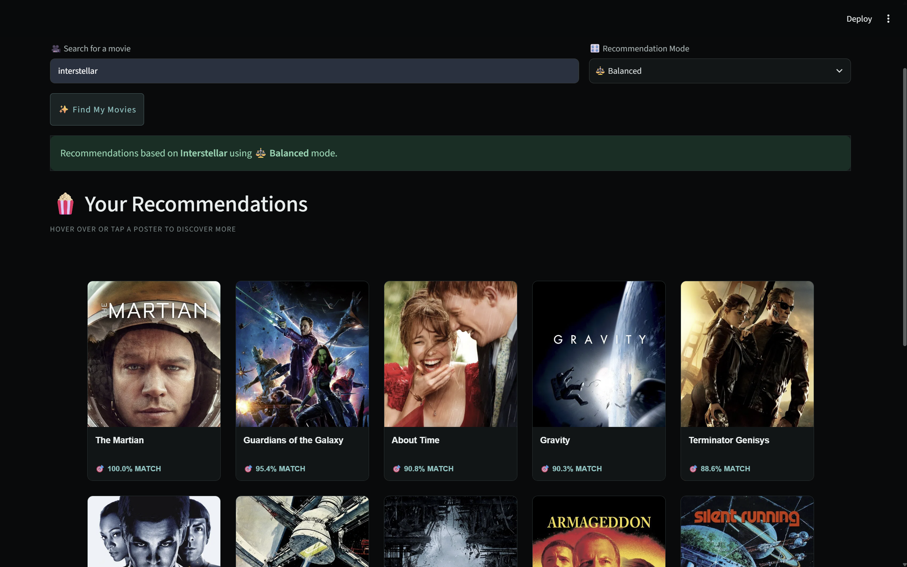
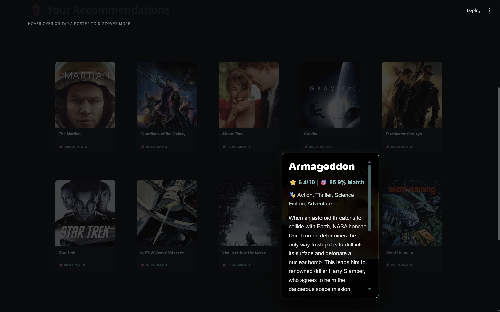

<p>
  
  
  
</p>

# CineMatch

A movie recommender I built with Python and Streamlit. You type in a movie you like, pick a mode, and it gives you 10 similar movies with a short note on why each one was picked.
Try CineMatch here: 

[](https://cinematch-movie-recommendation-system-15.streamlit.app)


## What it does

You search for a title and get 10 recommendations as poster cards. Hover over a card (or tap it on mobile) to see the rating, genres, plot, and the reasons it was recommended.

It's content-based, so it looks at what the movies are about, not at what other people watched. There's no training involved. It uses TF-IDF and cosine similarity from scikit-learn.

## How it works

1. Genres, keywords, and plot overviews are each turned into TF-IDF vectors.
2. For the movie you pick, I compute the cosine similarity against every other movie, separately for genres, keywords, and overview.
3. Those three scores are mixed into one content score. How much each one counts depends on the mode.
4. The final score is the content score plus a little popularity and a rating score. The rating is scaled by the number of votes, so a 9.0 from 12 votes doesn't beat an 8.0 from 10,000.
5. Movies that are barely similar, have under 100 votes, or are rated below 5 get dropped. The top 10 are shown.

The "match %" on each card is relative to the best result of that search, so the top pick always shows 100%. It's a ranking, not a probability.

## Modes

- **Balanced**: a mix of everything
- **Story Focus**: leans on keywords and plot
- **Genre Focus**: leans on genres
- **Popular Movies**: gives popularity more weight

## Running it locally

```bash
git clone https://github.com/Ganesh-1509/CineMatch-Movie-Recommendation-System.git
cd CineMatch-Movie-Recommendation-System
pip install streamlit pandas numpy scikit-learn requests
```

Posters come from the TMDB API, so you need a free API key from [themoviedb.org](https://www.themoviedb.org/). Create `.streamlit/secrets.toml` and add:

```toml
TMDB_API_KEY = "your_key_here"
```

Don't commit this file. It's already in `.gitignore`. Without a key the app still works, but you'll see placeholders instead of posters.

Then run:

```bash
python -m streamlit run app.py
```

## Dataset

I used the [TMDB 5000 Movie Dataset](https://www.kaggle.com/datasets/tmdb/tmdb-movie-metadata) from Kaggle. Only `tmdb_5000_movies.csv` is used. Put it in a `dataset/` folder next to `app.py`.

## Things that don't work well yet

- The dataset ends around 2017, so there are no recent movies.
- Search is plain text matching. If you type a partial title, it picks the matching movie with the most votes.
- It doesn't look at cast or directors, so sequels and franchises tend to dominate the results.
- I picked the weights by hand and haven't measured how good the recommendations are.

## What I want to add next

- Cast and director as features
- Better search with autocomplete
- A simple way to evaluate the recommendations
- A public deployment

## Credits

Movie data and posters from [TMDB](https://www.themoviedb.org/). This product uses the TMDB API but is not endorsed or certified by TMDB.

Built by [Ganesh](https://github.com/Ganesh-1509).
